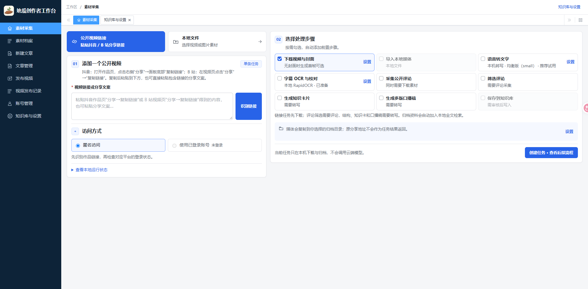
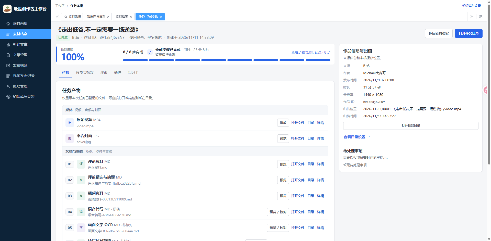
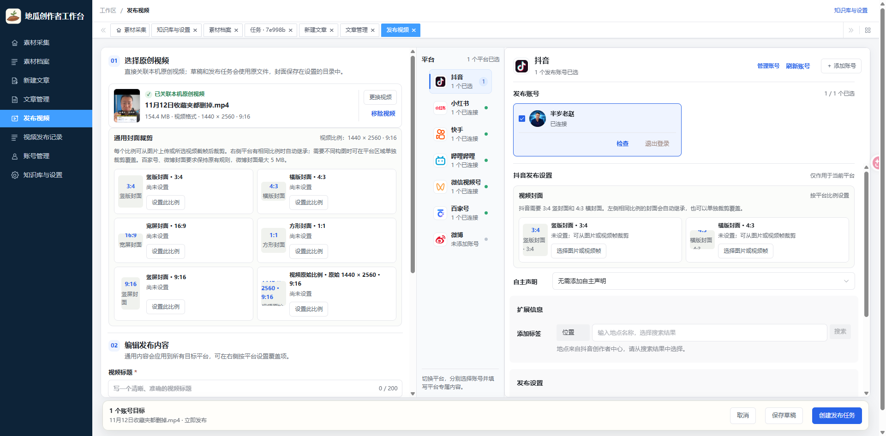
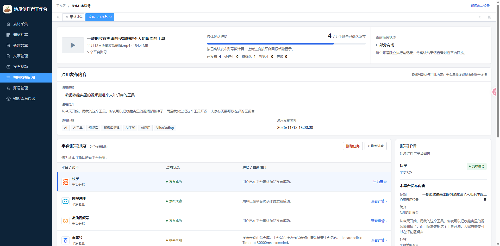

# ShortVideoDesk

**中文名（暂用）：地瓜创作者工作台**

ShortVideoDesk 是一套在本机浏览器里使用的短视频工具。你可以下载或导入素材，整理评论和转写稿，也可以管理文章和视频发布。

## 选哪个入口

| 入口 | 能做什么 | 启动脚本 |
| --- | --- | --- |
| **本地工作台** | 下载抖音和 B 站公开视频，导入本地音视频，采集可访问的评论，搜索素材、转写音频和整理内容 | Windows · [start-local.cmd](start-local.cmd) |
| **独立下载器** | 下载小红书、抖音、B 站和 YouTube 的内容，查看下载进度并重试失败项 | Windows · [start.bat](start.bat) · macOS · [start.command](start.command) · Linux · [start.sh](start.sh) |

独立下载器支持小红书和抖音的单条作品及主页链接，其中抖音主页下载为实验性功能。B 站和 YouTube 还支持播放列表。可下载的内容和画质取决于平台返回的数据、网络和账号权限。

## 启动本地工作台（Windows）

1. 安装 Python 3.11、Node.js（含 npm）、uv、Google Chrome 和 FFmpeg。确保 `ffmpeg` 和 `ffprobe` 可以在终端里运行。
2. 下载或克隆本仓库，在项目根目录打开 PowerShell，执行以下命令。

   ```powershell
   uv venv --seed .venv --python 3.11
   uv pip install --system-certs --python .venv\Scripts\python.exe -r requirements-poc.txt
   .\.venv\Scripts\python.exe -m playwright install chromium
   npm --prefix frontend ci
   ```

3. 双击 [start-local.cmd](start-local.cmd)。服务就绪后会打开浏览器。
4. 第一次使用时，在 **知识库与设置** 中选择素材归档目录，再粘贴链接或导入本地文件。

首次启动会自动创建 `data/workbench.sqlite3` 并初始化数据库，无需安装数据库服务或导入 SQL。任务和设置保存在本机，素材保存在你选择的归档目录。

## 启动独立下载器

安装 Python 3.10 或更新版本、Google Chrome 和 FFmpeg，然后按系统运行对应脚本。首次启动会安装 Python 依赖，页面地址是 [127.0.0.1:8766](http://127.0.0.1:8766)。

| 系统 | 操作 |
| --- | --- |
| Windows | 双击 [start.bat](start.bat) |
| macOS | 在项目目录运行 `bash start.command` |
| Linux | 在项目目录运行 `bash start.sh` |

切换入口前，在启动窗口按 **Ctrl+C** 停止当前程序。Windows 也可双击 [stop.bat](stop.bat)。

## 工作台的可选功能

- **音频转写**。可下载 faster-whisper 模型在本机转写，也可配置云端模型。
- **内容整理**。可对评论和转写稿做分析、生成知识卡或稿件，并在审阅后写入 Obsidian。
- **发布管理**。可编辑文章、准备视频发布任务并管理平台账号。视频发布需按界面提示配置兼容的 `social-auto-upload`。

服务只在本机运行。云端模型功能需要配置凭据，发送素材前会提示确认。请只保存和处理你有权使用的内容。

## 开发与反馈

项目使用 Vue、TypeScript、FastAPI 和 SQLite。工作台前端在 [frontend/src](frontend/src/)，后端在 [app/workbench](app/workbench/)。

遇到问题或有功能建议，优先提交 [GitHub Issue](https://github.com/adelychao/ShortVideoDesk/issues)，并说明操作系统、使用的入口和复现步骤。

## 联系与支持

如需项目交流或合作咨询，欢迎添加作者微信：


如果 ShortVideoDesk 对你有帮助，欢迎自愿请作者喝杯咖啡。打赏完全自愿，不影响软件使用。

| 微信支付 | 支付宝 |
| --- | --- |
|  |  |

## 许可证

本仓库的主许可证为 [GNU GPL-3.0-or-later](LICENSE)。源自 `rednote_downloader` 的代码保留原版权及 MIT 许可声明，详见 [第三方声明](THIRD_PARTY_NOTICES.md)。其他第三方依赖适用各自的许可证。

## 页面截图

### 素材采集



### 任务详情与产物归档



### 视频发布配置



### 发布任务进度


